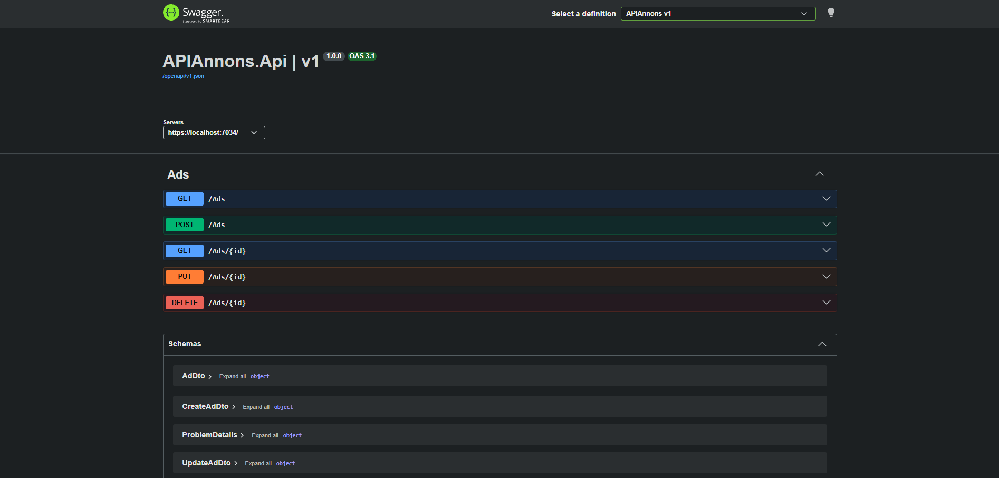

# 📢 APIAnnons – REST API för annonser

<p align="center">
    
</p>

Ett **RESTful Web API** för att hantera annonser, som grundfunktionerna på en köp- och säljsida.
Byggt med **ASP.NET Core Web API (controllers)**, **Entity Framework Core** och **SQL Server** med **Code First**.
Utvecklat som en del av utbildningen Systemutvecklare .NET på YH Akademin.
Projektet är byggt som ett riktigt API med fokus på REST-principer, rätt statuskoder, DTO:er och en tydlig struktur.

> API:t har inget eget gränssnitt. Det testas och dokumenteras med **Swagger UI**.

---

## 🔗 Endpoints

| Metod | URL | Gör | Lyckat | Fel |
|---|---|---|---|---|
| GET | `/Ads` | Listar alla annonser (nyaste först) | 200 | – |
| GET | `/Ads/{id}` | Hämtar en annons | 200 | 404 |
| POST | `/Ads` | Skapar en annons | 201 + Location | 400 |
| PUT | `/Ads/{id}` | Uppdaterar hela annonsen | 204 | 400 / 404 |
| DELETE | `/Ads/{id}` | Tar bort en annons | 204 | 404 |
| PATCH | `/Ads/{id}` | Uppdaterar delar av annonsen *(VG – kommer)* | 204 | 400 / 404 |

---

## 📦 Exempel

### Skapa en annons – `POST /Ads`
```json
{
  "title": "Cykel",
  "description": "Röd damcykel, 7 växlar",
  "price": 500,
  "category": "Fritid",
  "location": "Malmö"
}
```
Svar: **201 Created** med headern `Location: /Ads/1` och den nya annonsen.

---

## ✨ Funktionalitet

### 📋 Lista och hämta
- `GET /Ads` visar alla annonser sorterade med nyaste först
- `GET /Ads/{id}` ger en annons, eller **404** om den inte finns
- `AsNoTracking()` på alla läsningar, så att EF inte bevakar data i onödan
- `{id:int}` i routen, så att bara heltal matchar

### ➕ Skapa
- Klienten skickar en `CreateAdDto`, inte entiteten
- `Id` sätts av databasen och `CreatedAt` sätts av servern (`DateTime.UtcNow`)
- Svarar **201 Created** med `CreatedAtAction`, så att headern `Location` pekar på den nya annonsen

### ✏️ Uppdatera (PUT)
- Total uppdatering: alla fält ersätts
- **204 No Content** om det lyckas, **404** om annonsen inte finns

### 🗑️ Ta bort
- **204 No Content** om det lyckas, **404** om annonsen redan är borttagen eller aldrig har funnits

---

## 🧱 Arkitektur

```
Klient (Swagger)  →  AdsController  →  AppDbContext  →  SQL Server
                        ↑ DTO:er
```

- **Controllers:** tar emot anropet, väljer rätt statuskod och mappar mellan entitet och DTO
- **DTOs:** `AdDto` (ut), `CreateAdDto` och `UpdateAdDto` (in), så att klienten aldrig kan sätta `Id` eller `CreatedAt`
- **Models:** entiteten `Ad`
- **Data:** `AppDbContext` med maxlängd på texter och `decimal(18,2)` för pris
- **Migrations:** Code First, där `InitialCreate` skapar tabellen `Ads`

---

## ✅ Validering *(VG – kommer)*

- Data annotations på DTO:erna (`[Required]`, `[StringLength]`, `[Range]`)
- `[ApiController]` svarar automatiskt **400 Bad Request** med felmeddelanden

---

## 🧪 Tekniker

- .NET 10 / ASP.NET Core Web API (controllers)
- Entity Framework Core 10 (Code First) + LINQ
- SQL Server (LocalDB)
- OpenAPI + Swagger UI (Swashbuckle.AspNetCore.SwaggerUI)
- Git & GitHub

---

## 📁 Projektstruktur

```
APIAnnons.Api/
  Controllers/      AdsController
  Data/             AppDbContext
  DTOs/             AdDto, CreateAdDto, UpdateAdDto
  Models/           Ad
  Migrations/       InitialCreate
  Program.cs        DI, DbContext, OpenAPI och Swagger UI
image/              Bilder till README
APIAnnons.slnx
README.md
```

---

## 🛠️ Installation (F5)

**Krav:** Visual Studio 2026, .NET 10 SDK, SQL Server LocalDB (ingår i Visual Studio)

1. Klona repot och öppna `APIAnnons.slnx`
2. Öppna **Tools → NuGet Package Manager → Package Manager Console** och kör:
   ```
   Update-Database
   ```
3. Tryck **F5** – Swagger öppnas automatiskt på `/swagger`

Connection string finns i `APIAnnons.Api/appsettings.json` och pekar på `(localdb)\mssqllocaldb`, så inget behöver ändras.

---

## 🧩 Lärdomar & Arbetssätt

Jag arbetade enligt principer som:

- **REST:** rätt HTTP-metod och rätt statuskod för varje fall
- **Separation of concerns:** entiteten beskriver databasen och DTO:n beskriver vad klienten får skicka
- **DRY:** mappningen från entitet till DTO finns på ett ställe (`ToDto`)
- **En commit per steg**, så att historiken visar hur projektet har vuxit fram

Lärdomar:

- Från och med .NET 9 ingår inte Swagger UI. Mallen skapar bara OpenAPI-filen, och UI:t måste läggas till själv
- EF Core-paketen måste ha samma huvudversion som .NET, annars blir det konstiga fel
- `POST` ska ge **201** med en Location-header, inte 200
- Utan `HasMaxLength` blir alla strängar `nvarchar(max)` i databasen

---

## ✍️ Utvecklat av
**Ninnie Dahlström – Systemutvecklare .NET, YH Akademin**